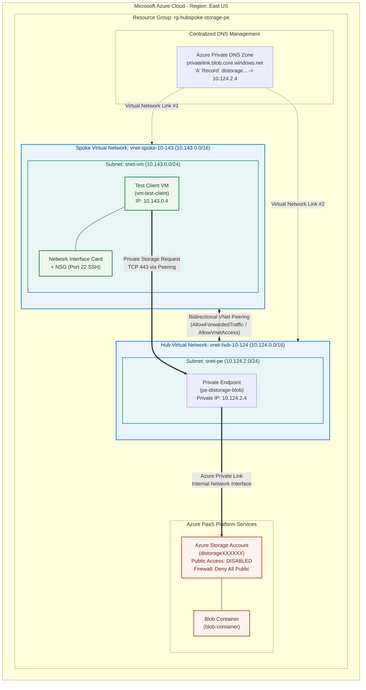
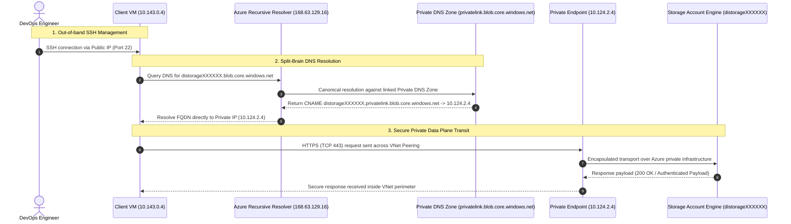
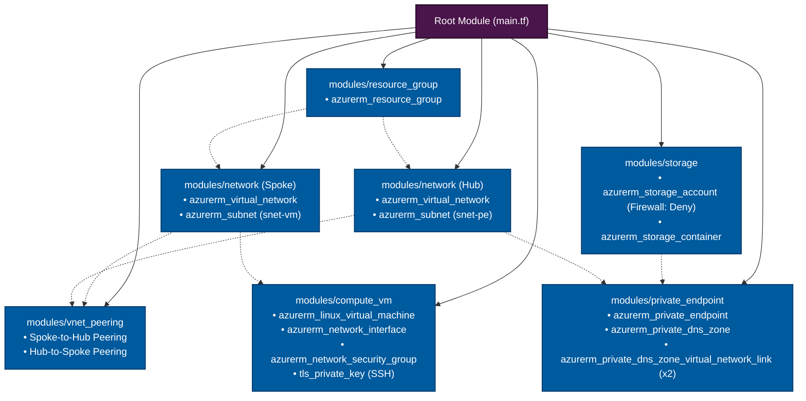

# Enterprise Azure Hub-Spoke Network with Private Endpoint & Private DNS Zone

[](https://www.terraform.io/)
[](https://azure.microsoft.com/)
[](#cicd-automation)
[](https://learn.microsoft.com/azure/private-link/)

Production-grade, modular Terraform framework implementing an **Azure Hub-Spoke Virtual Network Topology** with **Bidirectional VNet Peering**, an **Azure Private Endpoint** for **Azure Blob Storage**, and centralized **Azure Private DNS Zone** name resolution.

---

## 📑 Table of Contents

- [Architectural Overview](#architectural-overview)
- [System Architecture Diagrams](#system-architecture-diagrams)
  - [High-Level Infrastructure Architecture](#high-level-infrastructure-architecture)
  - [End-to-End DNS Resolution & Data Flow](#end-to-end-dns-resolution--data-flow)
  - [Terraform Module Hierarchy](#terraform-module-hierarchy)
- [Network & IP Addressing Schema](#network--ip-addressing-schema)
- [Repository Structure](#repository-structure)
- [Key Security Controls](#key-security-controls)
- [Prerequisites](#prerequisites)
- [Deployment Guide](#deployment-guide)
  - [1. Authentication & Azure Context](#1-authentication--azure-context)
  - [2. Initialize & Provision with Terraform](#2-initialize--provision-with-terraform)
  - [3. Extract Outputs & SSH Credentials](#3-extract-outputs--ssh-credentials)
- [Verification & Validation Runbook](#verification--validation-runbook)
  - [DNS Resolution Verification (CNAME Chaining)](#dns-resolution-verification-cname-chaining)
  - [Private Connectivity Verification](#private-connectivity-verification)
  - [Automated Verification Script](#automated-verification-script)
- [CI/CD Automation](#cicd-automation)
  - [GitHub Actions](#github-actions)
  - [Azure DevOps](#azure-devops)
- [Terraform Module Reference](#terraform-module-reference)
- [Clean-Up & Teardown](#clean-up--teardown)

---

## 🏛️ Architectural Overview

This infrastructure blueprints an enterprise Zero-Trust pattern for securely accessing Azure PaaS data stores from application workloads:

1. **Isolation & Segmentation**: Workload compute resides in a Spoke Virtual Network (`10.143.0.0/16`), while shared transit services and Private Endpoints reside in a Hub Virtual Network (`10.124.0.0/16`).
2. **Private Transit**: Communication between VNets occurs over high-performance **Bidirectional VNet Peering** via the Microsoft global backbone (never traversing the public internet).
3. **Data Exfiltration Prevention**: The Azure Storage Account enforces `public_network_access_enabled = false`. Ingress is strictly confined to a network interface associated with an Azure Private Endpoint in the Hub subnet (`10.124.2.0/24`).
4. **Seamless DNS Integration**: A centralized Azure Private DNS Zone (`privatelink.blob.core.windows.net`) is linked to both Spoke and Hub VNets, enabling automatic split-brain DNS resolution for client VMs.

---

## 📐 System Architecture Diagrams

### High-Level Infrastructure Architecture



---

### End-to-End DNS Resolution & Data Flow



---

### Terraform Module Hierarchy



---

## 🌐 Network & IP Addressing Schema

| Network Layer | Resource Name | CIDR / IP Allocation | Purpose & Constraints |
|---|---|---|---|
| **Spoke VNet** | `vnet-spoke-10-143` | `10.143.0.0/16` | Hosts client application workloads and testing compute |
| ↳ **Subnet** | `snet-vm` | `10.143.0.0/24` | Workload compute subnet |
| ↳ **VM NIC** | `vm-test-client-nic` | `10.143.0.4` (Dynamic) | Client VM network interface |
| **Hub VNet** | `vnet-hub-10-124` | `10.124.0.0/16` | Centralized transit hub for shared services and Private Endpoints |
| ↳ **Subnet** | `snet-pe` | `10.124.2.0/24` | Dedicated subnet for Azure Private Endpoints |
| ↳ **Private Endpoint** | `pe-distorage*-blob` | `10.124.2.4` (Dynamic) | Static/assigned private IP mapped to the Storage Account Blob sub-resource |
| **Peering Connection** | `spoke-to-hub` / `hub-to-spoke` | Layer 3 Transit | Bidirectional, full mesh peering with forwarded traffic enabled |
| **Private DNS Zone** | `privatelink.blob.core.windows.net` | Internal Resolver | Linked to `10.143.0.0/16` & `10.124.0.0/16` |

---

## 📁 Repository Structure

```text
azure-peering-private-endpoint/
├── .github/
│   └── workflows/
│       └── terraform.yml            # GitHub Actions CI/CD (Validation, Security Scan, Plan, Apply)
├── azure-pipelines.yml              # Azure DevOps Multi-Stage Pipeline YAML
├── modules/
│   ├── resource_group/              # Module: Azure Resource Group management
│   │   ├── main.tf, variables.tf, outputs.tf
│   ├── network/                     # Module: VNet, Dynamic Subnets & PE Delegation Policies
│   │   ├── main.tf, variables.tf, outputs.tf
│   ├── compute_vm/                  # Module: Ubuntu 22.04 LTS VM, NIC, NSG & TLS SSH Key
│   │   ├── main.tf, variables.tf, outputs.tf
│   ├── vnet_peering/                # Module: Bidirectional Azure VNet Peering links
│   │   ├── main.tf, variables.tf, outputs.tf
│   ├── storage/                     # Module: Secure Storage Account & Private Blob Container
│   │   ├── main.tf, variables.tf, outputs.tf
│   └── private_endpoint/            # Module: Private Endpoint, Private DNS Zone & Multi-VNet Links
│       ├── main.tf, variables.tf, outputs.tf
├── main.tf                          # Root Orchestrator wiring all modules
├── variables.tf                     # Root variables definition & type constraints
├── terraform.tfvars                 # Environment deployment parameters
├── outputs.tf                       # Connection strings, IPs, and deployment artifacts
├── backend.tf                       # Azure Blob Storage remote state configuration
├── versions.tf                      # Required providers: hashicorp/azurerm (~> 3.100), hashicorp/tls
└── test_connectivity.sh             # Automated end-to-end verification script for the client VM
```

---

## 🔒 Key Security Controls

- **Zero Public Exposure**: The Storage Account is deployed with `public_network_access_enabled = false` and default network rules set to `Deny`. All public internet connections are blocked at the Azure edge.
- **Micro-Segmentation via NSGs**: The VM subnet has an associated Network Security Group restricting inbound traffic. SSH port 22 access can be tightened to specific source CIDRs via `var.vm_ssh_allowed_source_ip`.
- **Ephemeral SSH Key Management**: Root-level RSA 4096-bit private keys are generated dynamically during `terraform apply` and stored as sensitive values, preventing hardcoded credentials in source control.
- **Private Link Architecture**: Data plane traffic never crosses the public internet or public Azure endpoints; requests travel exclusively within the Microsoft backbone.

---

## ⚙️ Prerequisites

Before deploying, ensure you have the following tools installed and configured:

- [Azure CLI](https://learn.microsoft.com/cli/azure/install-azure-cli) (v2.50.0+)
- [Terraform CLI](https://developer.hashicorp.com/terraform/downloads) (v1.5.0+)
- Active Azure Subscription with **Contributor** and **User Access Administrator** (or **Owner**) role permissions.

---

## 🚀 Deployment Guide

### 1. Authentication & Azure Context

Authenticate with your Azure subscription:

```bash
# Log in to your Azure tenant
az login

# List and set the target subscription
az account list --output table
az account set --subscription "<YOUR_SUBSCRIPTION_ID>"
```

### 2. Initialize & Provision with Terraform

Navigate to the project root and execute the provisioning workflow:

```bash
# 1. Initialize Terraform providers and backend
terraform init

# 2. Validate configuration syntax and consistency
terraform validate

# 3. Generate and inspect the execution plan
terraform plan -out=tfplan

# 4. Apply configuration to Azure
terraform apply "tfplan"
```

### 3. Extract Outputs & SSH Credentials

Once provisioning completes, extract the private key and target IP:

```bash
# Export the generated private key to an identity file
terraform output -raw vm_ssh_private_key > id_rsa

# Restrict file permissions (required by OpenSSH client)
chmod 400 id_rsa

# Retrieve connection details
VM_IP=$(terraform output -raw vm_public_ip)
STORAGE_NAME=$(terraform output -raw storage_account_name)

echo "Client VM Public IP: ${VM_IP}"
echo "Storage Account: ${STORAGE_NAME}"
```

Connect to the client VM via SSH:

```bash
ssh -i id_rsa azureuser@${VM_IP}
```

---

## 🧪 Verification & Validation Runbook

Run these tests **inside the client VM** (`vm-test-client`) to confirm end-to-end functionality.

### DNS Resolution Verification (CNAME Chaining)

Verify that the VM resolves the storage account to the **Private Endpoint IP** (`10.124.2.4`) instead of a public Azure IP:

```bash
nslookup <STORAGE_ACCOUNT_NAME>.blob.core.windows.net
```

**Expected Terminal Output:**
```text
Server:         127.0.0.53
Address:        127.0.0.53#53

Non-authoritative answer:
<STORAGE_ACCOUNT_NAME>.blob.core.windows.net       canonical name = <STORAGE_ACCOUNT_NAME>.privatelink.blob.core.windows.net.
Name:   <STORAGE_ACCOUNT_NAME>.privatelink.blob.core.windows.net
Address: 10.124.2.4
```

> **Key Observation:** Notice the CNAME redirection to `.privatelink.blob.core.windows.net` resolving directly to the Hub VNet subnet address `10.124.2.4`.

### Private Connectivity Verification

Test HTTPS connectivity to the Blob service endpoint:

```bash
curl -I -k "https://<STORAGE_ACCOUNT_NAME>.blob.core.windows.net/" --connect-timeout 5
```

**Expected Response Headers:**
```http
HTTP/1.1 400 Bad Request
Server: Microsoft-Azure-Storage/1.0
x-ms-request-id: 9a2b8e4f-...
Date: Mon, 02 Nov 2026 00:00:00 GMT
```

> **Validation Note:** A `400 Bad Request` or `403 Server failed to authenticate the request` response carrying the `Server: Microsoft-Azure-Storage/1.0` header verifies that the TCP connection succeeded over the private link and reached the Azure Storage service engine. If public network access were blocked without a private endpoint, the request would result in a `Connection timed out` or `403 Public Access Denied`.

### Automated Verification Script

An automated test script is provided in the repository root. Transfer and run it inside the VM:

```bash
# On your local machine:
scp -i id_rsa test_connectivity.sh azureuser@${VM_IP}:~/

# Inside the VM:
chmod +x test_connectivity.sh
./test_connectivity.sh <STORAGE_ACCOUNT_NAME>
```

---

## 🔄 CI/CD Automation

This repository includes enterprise-ready deployment pipelines for both **GitHub Actions** and **Azure DevOps**.

### GitHub Actions

Workflow file: [`.github/workflows/terraform.yml`](file:///.github/workflows/terraform.yml)

Configure the following secrets in **Settings > Secrets and variables > Actions**:

| Secret Name | Description |
|---|---|
| `AZURE_CLIENT_ID` | Service Principal App ID |
| `AZURE_CLIENT_SECRET` | Service Principal Client Secret |
| `AZURE_TENANT_ID` | Azure Tenant / Directory ID |
| `AZURE_SUBSCRIPTION_ID` | Azure Subscription ID |
| `TFSTATE_RG` | Resource Group for Remote State Storage |
| `TFSTATE_STORAGE_ACCOUNT` | Storage Account for `.tfstate` |
| `TFSTATE_CONTAINER` | Blob Container name (e.g. `tfstate`) |

- **Pull Requests**: Runs `terraform fmt -check`, `terraform validate`, security linting with `trivy`/`tfsec`, and posts a `terraform plan` summary directly to the PR comments.
- **Merge to `main`**: Runs `terraform apply` with remote state locking.

### Azure DevOps

Pipeline definition: [`azure-pipelines.yml`](file:///azure-pipelines.yml)

- Utilizes native Azure Resource Manager Service Connections (`azurerm`).
- Two-stage architecture: **Plan** (with artifact publishing) and **Apply** (with environment approval gates).

---

## 📊 Terraform Module Reference

### Root Inputs

| Name | Type | Default | Description |
|---|---|---|---|
| `resource_group_name` | `string` | `"rg-hubspoke-storage-pe"` | Name of the primary resource group |
| `location` | `string` | `"eastus"` | Azure region for all provisioned resources |
| `vnet_spoke_address_space` | `list(string)` | `["10.143.0.0/16"]` | CIDR address block for Spoke VNet |
| `snet_vm_address_prefixes` | `list(string)` | `["10.143.0.0/24"]` | CIDR subnet block for client VM |
| `vnet_hub_address_space` | `list(string)` | `["10.124.0.0/16"]` | CIDR address block for Hub VNet |
| `snet_pe_address_prefixes` | `list(string)` | `["10.124.2.0/24"]` | CIDR subnet block for Private Endpoints |
| `storage_account_prefix` | `string` | `"distorage"` | Prefix for unique storage account naming |
| `vm_size` | `string` | `"Standard_B1s"` | SKU for the test client VM |
| `vm_enable_public_ip` | `bool` | `true` | Associates public IP to VM for SSH validation |

### Root Outputs

| Name | Description |
|---|---|
| `storage_account_name` | Globally unique name generated for the Storage Account |
| `storage_blob_fqdn` | Fully Qualified Domain Name of the Blob service |
| `private_endpoint_ip` | Private IP address assigned to the Storage Private Endpoint (`10.124.2.4`) |
| `vm_public_ip` | Public IP address for client VM SSH management |
| `vm_private_ip` | Internal IP assigned to the client VM (`10.143.0.4`) |
| `vm_ssh_command` | Pre-formatted OpenSSH connection command |

---

## 🧹 Clean-Up & Teardown

To avoid incurring ongoing Azure infrastructure charges, destroy all created resources:

```bash
# Destroy all managed infrastructure
terraform destroy -auto-approve

# Clean up local temporary credentials
rm -f id_rsa tfplan
```
